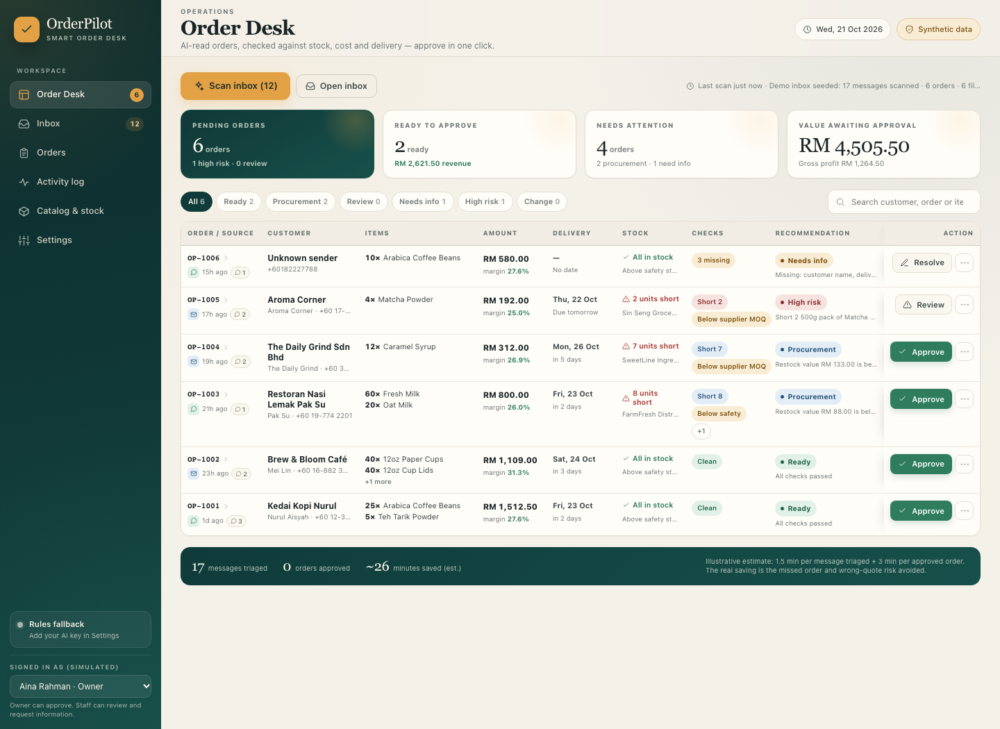
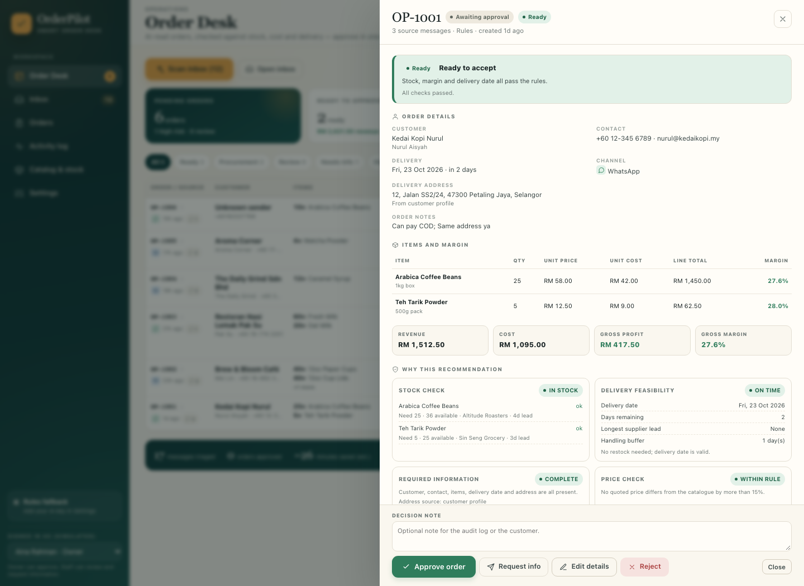
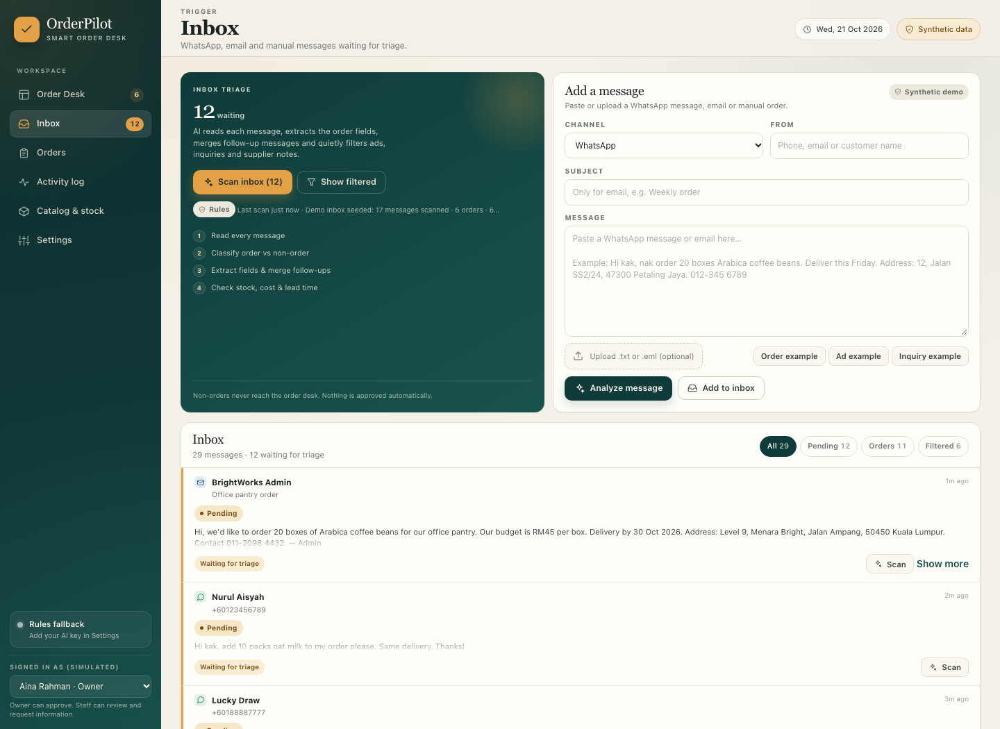
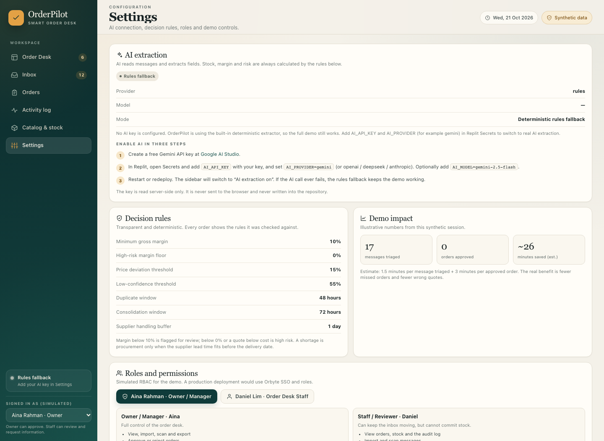
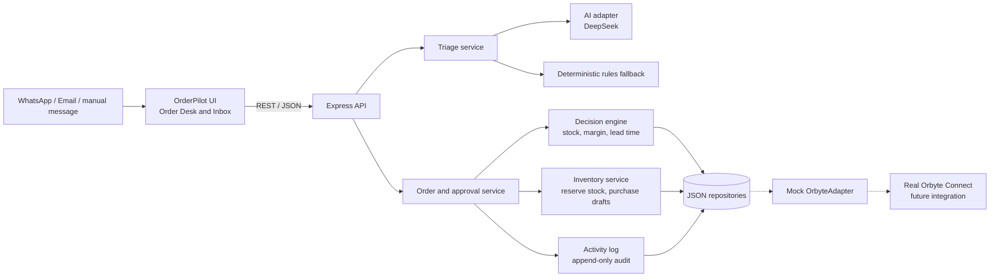

# OrderPilot

**Smart order consolidation and human approval for Malaysian SMEs.**

OrderPilot turns scattered WhatsApp messages, emails and manual notes into one verified order desk. AI reads each message and extracts the order; deterministic rules check stock, cost, margin and supplier lead time; a human owner or manager approves every consequential action. Every import, analysis, approval, stock change and purchase-draft action is written to an activity log.

> Built for **SDC Hackathon 2026 — Domain 2: Orbyte Smart SME Challenge**.
> SDG 8 — Decent Work and Economic Growth, sub-targets **8.2** and **8.3**.

---

## Team Information

| Field | Details |
| --- | --- |
| **Team Name** | Empathy Coders |
| **Team Domain** | Domain 2 — Orbyte Smart SME Challenge |
| **SDG Track (1–17)** | SDG 8 — Decent Work and Economic Growth (8.2 / 8.3) |
| **Team Leader** | Yang Jiahui (杨嘉辉) |
| **University** | Xiamen University Malaysia (XMUM) |
| **Number of Members** | 5 |
| **Members** | Guo Huiyi (郭慧怡), Yang Sicheng (杨思成), Yuan Zhanruiyu (袁战瑞昱), Hu Tiejing (胡铁竞) |

## Links

| Resource | Link |
| --- | --- |
| **GitHub Repository** | [https://github.com/Jacky-Godlike/Empathy-Coders](https://github.com/Jacky-Godlike/Empathy-Coders) |
| **Replit Project** | `<REPLIT_PROJECT_URL>` |
| **Live Demo** | [https://order-pilot--microtopt.replit.app](https://order-pilot--microtopt.replit.app) |
| **RunPod Endpoint** | **Not applicable — no GPU workload** |
| **Slide Deck** | `<SLIDE_DECK_URL>` |
| **Pitch Video (5–7 min)** | `<PITCH_VIDEO_URL>` |
| **Proposal PDF** | [`submission/SDC2026_EmpathyCoders_Preliminary.pdf`](submission/SDC2026_EmpathyCoders_Preliminary.pdf) |
| **Technical Declaration PDF** | [`submission/SDC2026_EmpathyCoders_TechDeclaration.pdf`](submission/SDC2026_EmpathyCoders_TechDeclaration.pdf) |

> **Before submission:** replace the remaining placeholders (`<REPLIT_PROJECT_URL>`, `<SLIDE_DECK_URL>`, `<PITCH_VIDEO_URL>`) with the final links. The live demo is deployed; the Replit project URL is copied from the Replit address bar. The official deadline is **25 October 2026, 7:59:59 AM MYT**. Open every link in an incognito window before submitting.

---

## Overview

### Problem

A Malaysian café supplier receives orders through WhatsApp, email, phone calls and a paper notebook. One customer sends three messages: the initial order, an extra item and a correction. Another writes “40 sleeves of 12oz cups” in an email. A third asks for a price list, which is not an order at all.

The owner has to read every message, copy the details into a spreadsheet, check stock, calculate cost and margin, guess whether a supplier can restock before the delivery date, and chase missing addresses. This repetitive work happens after closing, on a phone, with no audit trail. A missed message becomes a missed sale. A copied quantity becomes a wrong delivery. A quote below cost is discovered after the invoice. Staff with different levels of digital confidence do the same task differently, and there is no reliable record of who approved what.

The target users are Malaysian micro and small businesses in food service, retail and distribution. They already use WhatsApp, email and spreadsheets; they cannot afford a custom ERP or weeks of training. They need one reliable, easy-to-learn workflow that connects the order to business data, surfaces the risk, keeps a human in control and leaves a record.

### Solution

OrderPilot is a single web application with one hero screen — the **Order Desk** — and five supporting screens:

1. **Order Desk** — one tidy table. Each row is a consolidated order, not a message. Columns show the customer, items, amount, delivery, stock, checks and recommendation. The manager approves from the far right.
2. **Inbox** — paste a WhatsApp/email message or upload a `.txt`/`.eml` file; run a batch scan. AI classifies each message, extracts fields, merges follow-ups and quietly filters ads, inquiries, supplier pitches and spam.
3. **Orders & purchases** — approved/rejected order records, internal purchase drafts and CSV/XLSX exports.
4. **Activity log** — an append-only audit trail of every import, analysis, approval, rejection, stock reservation and purchase-draft action.
5. **Catalog & stock** — products, available stock, safety levels, suppliers, lead times and the synthetic customer master.
6. **Settings** — AI connection, the exact decision rules, simulated roles and permissions, Orbyte adapter, privacy notes and a demo reset.

### Key Features

- **One order interface, not a message queue.** AI extracts the fields; the owner only reviews a clean row and clicks the decision on the right.
- **AI for reading, rules for money.** AI classifies and extracts only. Stock, shortage, safety stock, supplier lead time, revenue, cost, gross profit, margin, price deviation, duplicates and missing fields are calculated by deterministic rules.
- **Order consolidation.** Follow-ups from the same customer within 72 hours merge into the same order: add items, replace items, remove items or update the delivery date.
- **Transparent recommendations.** Ready to accept, Procurement needed, Review recommended, Customer info needed, High risk or Change request — each with visible reasons.
- **Human approval by default.** Only the Owner/Manager can approve, reject or edit. High-risk approvals require a written justification. Staff can review and request information; the server returns **403** if a staff actor tries to approve.
- **Stock and procurement side effects.** Approval reserves stock and creates internal purchase drafts for shortages. Receiving a draft updates stock and reservations.
- **Audit trail and exports.** Append-only activity log with actor, role, action, entity and details; CSV and XLSX exports with Excel-safe formatting.
- **Replit-first and secret-safe.** No build step. JSON data with a committed synthetic seed. API keys live in Replit Secrets or a gitignored `.env`; they are never sent to the browser or committed.
- **Rules fallback.** If the AI key is missing or the API fails, the deterministic extractor runs the entire demo. The UI labels which mode ran.

### Tech Stack

| Layer | Technology |
| --- | --- |
| Frontend | Semantic HTML5, hand-written CSS design system, vanilla JavaScript ES modules |
| Backend | Node.js 20+, Express 4 |
| Data | JSON files (seed committed; runtime gitignored) with atomic writes and a serialized write queue |
| AI | DeepSeek-V4.1-Flash (`deepseek-flash`) via the OpenAI-compatible `chat/completions` API; Gemini, OpenAI, Anthropic and other OpenAI-compatible endpoints are supported |
| Fallback | Deterministic extraction/classification engine — no key required |
| Exports | ExcelJS + a small CSV writer |
| Testing | Node.js built-in `node:test` — 42 tests |
| Hosting | Replit (required by the competition) |
| GPU / RunPod | **None — not used.** No training, fine-tuning or GPU inference |

---

## The Domain Journey

| Challenge requirement | How OrderPilot demonstrates it |
| --- | --- |
| **Trigger** | A WhatsApp/email message arrives in the Inbox, or the owner pastes/uploads one. |
| **Connected data** | The order is matched to the synthetic customer master, product catalogue, stock, safety stock, supplier lead times and costs through the `OrbyteAdapter`. |
| **Decision logic** | Transparent rules calculate available stock, shortage, restock feasibility, revenue, cost, gross profit, margin, missing fields, price deviation and duplicates. |
| **Human approval** | Only the Owner/Manager can approve, reject or edit. High-risk orders require a written justification. Staff can review and request information. |
| **Visible outcome** | Approval creates an order record, reserves stock, creates purchase drafts for shortages, and writes an activity entry. The result is visible immediately and exportable. |

### Decision Rules (visible in the app)

| Rule | Default | Behaviour |
| --- | --- | --- |
| Minimum gross margin | 10% | Below this → “Review recommended”, still approvable. |
| Margin floor | 0% | Below this, or a quote below unit cost → “High risk”, requires a note to override. |
| Price deviation | 15% | Quoted price more than 15% away from catalogue → review flag. |
| Low confidence | 55% | Extraction below this → review flag. |
| Duplicate window | 48 hours | Same customer + overlapping items → possible duplicate. |
| Consolidation window | 72 hours | Follow-ups from the same customer merge into one order. |
| Handling buffer | 1 day | Added to supplier lead time before checking the delivery date. |

A shortage becomes **Procurement needed** only when the supplier lead time fits before the delivery date. Otherwise it becomes **High risk** because the deadline cannot be met. AI never decides stock, margin or risk.

---

## Screenshots

| Order Desk | Order detail drawer |
| --- | --- |
|  |  |

| Inbox triage | Settings & rules |
| --- | --- |
|  |  |

> Screenshots in the repository use a system-font fallback because the headless test environment cannot reach Google Fonts. The live app loads DM Sans and Fraunces when the network allows it.

---

## Project Structure

```text
OrderPilot/
├── data/
│   ├── seed/                     # committed synthetic dataset
│   │   ├── products.json
│   │   ├── suppliers.json
│   │   ├── stock.json
│   │   ├── customers.json
│   │   ├── users.json
│   │   ├── messages.json
│   │   ├── orders.json
│   │   ├── activities.json
│   │   └── purchase-drafts.json
│   └── runtime/                  # generated at boot; gitignored
├── docs/
│   ├── ARCHITECTURE.md           # architecture, data model, rules, security
│   ├── API.md                    # endpoint reference and curl walkthrough
│   ├── DEMO_SCRIPT.md            # 5–7 minute demo script
│   ├── PITCH_OUTLINE.md          # 11-slide pitch deck outline
│   ├── ORBYTE_ADAPTER.md         # adapter contract and real integration path
│   ├── PRIVACY.md                # synthetic data and PDPA principles
│   ├── REPLIT_DEPLOY.md          # GitHub → Replit deployment guide
│   ├── SUBMISSION_PRD_DRAFT.md   # working PRD draft
│   ├── TECH_DECLARATION_DRAFT.md # working technical declaration draft
│   └── screenshots/              # UI screenshots
├── public/
│   ├── index.html
│   ├── css/app.css
│   └── js/
│       ├── app.js                # shell, routing, global actions
│       ├── api.js
│       ├── ui.js
│       ├── icons.js
│       ├── components/
│       └── pages/
├── scripts/
│   ├── seed.js
│   ├── reset-demo.js
│   └── generate_submission_pdfs.py
├── server/
│   ├── index.js                  # entry point
│   ├── app.js                    # Express routes, RBAC, exports
│   ├── bootstrap.js              # dependency wiring
│   ├── config.js
│   ├── domain/                   # dates, money, validation, constants
│   ├── repositories/             # JSON store and repositories
│   ├── services/                 # triage, consolidation, decisions, approvals
│   └── adapters/
│       ├── ai/                   # provider adapters + rules fallback
│       └── orbyte/               # mock OrbyteAdapter contract
├── submission/
│   ├── SDC2026_EmpathyCoders_Preliminary.pdf
│   ├── SDC2026_EmpathyCoders_TechDeclaration.pdf
│   ├── SDC2026_EmpathyCoders_ReplitProof.pdf      # screenshot template
│   ├── SDC2026_EmpathyCoders_RunPod_NotUsed.pdf   # no-GPU declaration
│   └── README.md                 # submission file map and checklist
├── tests/
├── .env.example
├── .gitignore
├── .replit
├── LICENSE                       # Apache License 2.0
├── package.json
├── package-lock.json
└── README.md
```

---

## Architecture

### Data Flow



### Text Version

```text
WhatsApp / Email / manual message
              │
              ▼
OrderPilot browser UI  ──REST──►  Express API
                                      │
                    ┌─────────────────┼─────────────────┐
                    ▼                 ▼                 ▼
              Triage service    Order/approval     Inventory + activity
                    │              service
                    ▼                 │
        AI adapter (DeepSeek)         ▼
        + rules fallback        Decision engine
                    │           stock · shortage · lead time
                    │           revenue · cost · margin · price
                    │           duplicates · missing fields
                    └─────────────────┘
                                      │
                                      ▼
                            JSON repositories
                                      │
                                      ▼
                            Mock OrbyteAdapter
                                      │
                                      ▼
                            Real Orbyte Connect (future)
```

**Design principle:** AI is used only for classification and field extraction. Every business number and every approval decision is deterministic, visible in the UI and recorded in the activity log.

---

## How to Run

### Option 1 — Run on Replit (recommended for judges)

1. Open the live demo at [https://order-pilot--microtopt.replit.app](https://order-pilot--microtopt.replit.app), or open the Replit project (`<REPLIT_PROJECT_URL>`). To create a new Repl, use **Create Repl → Import from GitHub** and select `Jacky-Godlike/Empathy-Coders`.
2. Open **Secrets** (🔒) and add the AI variables:
   - `AI_PROVIDER` = `deepseek` (or `gemini`, `openai`, `anthropic`, `openai-compatible`, `auto`)
   - `AI_API_KEY` = your provider key
   - `AI_MODEL` = `deepseek-flash` (or the model for your provider)
3. Click **Run**. The `.replit` file starts `npm start`; Replit installs dependencies from `package-lock.json`.
4. Open the Webview. The app seeds itself with 6 pending orders and 12 pending messages.
5. Deploy with **Deployments** and copy the public URL into this README and the declaration PDF.

> The app also runs without an AI key: the deterministic rules fallback keeps the full demo working. The UI labels the mode honestly.

### Option 2 — Run locally

```bash
# 1. Clone the repository
git clone https://github.com/Jacky-Godlike/Empathy-Coders.git
cd Empathy-Coders

# 2. Install dependencies
npm install

# 3. Create the local environment file
cp .env.example .env
# Then edit .env and add AI_PROVIDER, AI_API_KEY and AI_MODEL if you want live AI.
# Without a key, the rules fallback runs automatically.

# 4. Start the app
npm start
```

Open **http://localhost:3000**.

The app seeds itself on first boot with:

- 6 pre-analysed orders on the Order Desk
- 12 pending messages in the Inbox
- 10 synthetic customers
- 16 products, 5 suppliers, stock and safety levels

Click **Scan inbox** to run the live batch. Click **Reset demo data** in Settings to restore the starting state.

### Run the Tests

```bash
npm test
```

The suite has **42 tests** covering extraction, consolidation, date parsing, decision rules, AI-result normalization and the API/approval flow. It runs entirely on synthetic data and does not require an AI key.

### Enable AI Extraction

The app supports DeepSeek, Google Gemini, OpenAI, Anthropic and any OpenAI-compatible endpoint. The submitted demo uses **DeepSeek**:

```env
AI_PROVIDER=deepseek
AI_API_KEY=your-key-here
AI_MODEL=deepseek-flash
```

For Gemini:

```env
AI_PROVIDER=gemini
AI_API_KEY=your-key-here
AI_MODEL=gemini-2.5-flash
```

The key is read server-side only. It is never sent to the browser, logged or committed. `.env` is gitignored; use Replit Secrets for deployments. Settings → **Test connection** verifies the provider.

**Fallback behaviour:** if the AI request fails, times out, returns invalid JSON or is rate-limited, the batch automatically falls back to the deterministic extractor. The scan result shows the fallback reason, so the demo never depends on a live network call.

---

## How We Use Replit *(Required)*

- **Development:** the project was built and tested in a Replit workspace and through the Replit Webview. The `npm start` workflow, the seeded JSON data and the no-build frontend keep the Replit environment simple.
- **Hosting:** the app is deployed with **Replit Deployments** from the GitHub repository. The live URL is added to the Links table and to the Technical Declaration.
- **Secrets:** the AI key is stored in **Replit Secrets**, never in the repository. The same variable names are documented in `.env.example`.
- **Live deployment:** [https://order-pilot--microtopt.replit.app](https://order-pilot--microtopt.replit.app). The API is mounted at `/orderpilot-api` in this deployment; the frontend detects the Replit host and uses that mount.
- **Proof of use:** [`submission/SDC2026_EmpathyCoders_ReplitProof.pdf`](submission/SDC2026_EmpathyCoders_ReplitProof.pdf) is the three-screenshot template. Replace the dashed boxes with screenshots from the team's own Replit account before submitting.
- **Guide:** [`docs/REPLIT_DEPLOY.md`](docs/REPLIT_DEPLOY.md) has the full import, Secrets, deploy and proof steps.

## How We Use RunPod *(Required)*

**Not applicable — RunPod was not used. No GPU workload exists in this project.**

OrderPilot is a CPU-only Node.js/Express application. The AI model is a hosted API (DeepSeek `chat/completions`); the team did not train, fine-tune or run GPU inference. The US$25 RunPod credit was not used, and there is no RunPod endpoint, Pod, GPU type or usage record.

This is stated explicitly in:

- [`submission/SDC2026_EmpathyCoders_TechDeclaration.pdf`](submission/SDC2026_EmpathyCoders_TechDeclaration.pdf) — Section 5, RunPod = Not used
- [`submission/SDC2026_EmpathyCoders_RunPod_NotUsed.pdf`](submission/SDC2026_EmpathyCoders_RunPod_NotUsed.pdf) — one-page signed declaration

No `runpod/` folder is included because there is no GPU handler to deploy.

---

## API Summary

All endpoints are under `/api`. The demo uses a simulated actor header:

```http
X-OrderPilot-User: u-aina
```

`u-aina` is the Owner/Manager; `u-daniel` is Staff. The server enforces permissions. See [`docs/API.md`](docs/API.md) for the full reference.

| Method | Endpoint | Purpose |
| --- | --- | --- |
| GET | `/api/health` | Health and AI mode |
| GET | `/api/bootstrap` | User, AI status, rules, stats, Orbyte capabilities |
| GET | `/api/messages` | Inbox messages |
| POST | `/api/messages/import` | Add a message to the inbox |
| POST | `/api/messages/import-and-analyze` | Add and process one message |
| POST | `/api/triage/run` | Process all pending messages |
| POST | `/api/triage/messages/:id` | Process one message |
| GET | `/api/orders?status=pending` | Order Desk rows |
| GET | `/api/orders/:id` | Full order detail with sources and activity |
| POST | `/api/orders/:id/approve` | Human approval |
| POST | `/api/orders/:id/reject` | Rejection with reason |
| POST | `/api/orders/:id/request-info` | Generate a reply draft |
| PATCH | `/api/orders/:id` | Correct extracted fields |
| GET | `/api/purchase-drafts` | Internal purchase drafts |
| POST | `/api/purchase-drafts/:id/receive` | Receive stock and reserve it |
| GET | `/api/activity` | Audit trail |
| GET | `/api/catalog` | Products, stock, suppliers, customers |
| GET | `/api/orders/export?format=csv\|xlsx` | Export orders |
| GET | `/api/activity/export?format=csv\|xlsx` | Export the audit log |
| POST | `/api/demo/reset` | Manager-only demo reset |

---

## Security, Privacy & Competition Boundaries

- **Synthetic data only.** Every customer, phone number, email, address, product, supplier and order is fictional. No real Orbyte platform is connected.
- **No real payments, statutory filings or supplier purchase orders.** Purchase drafts are internal reminders. Nothing is sent automatically.
- **AI is server-side only.** Keys live in Replit Secrets or a gitignored `.env`; never in GitHub or the browser.
- **RBAC is enforced on the server.** Staff cannot approve, reject, edit or reset the demo. The server returns 403, not just a hidden button.
- **Audit trail.** Every import, analysis, approval, rejection and stock change is logged. The demo reset is also logged.
- **Input validation and limits.** Request sizes are bounded, AI endpoints are rate-limited, and user text is rendered with `textContent`, not HTML injection.
- **PDPA principles.** Purpose limitation, data minimisation, retention, role-based access and an audit trail are described in [`docs/PRIVACY.md`](docs/PRIVACY.md).
- **No secrets in this repository.** Search the repository for `AI_API_KEY`, `sk-` or `AIza` before submitting; only `.env.example` placeholders should appear.

---

## Challenges & Learnings

- **From messages to orders.** The first prototype was a message list with extracted fields. Testing showed the owner still had to compare messages one by one. We changed the primary object from “message” to “consolidated order” and made one table the default screen.
- **Mixed language and noise.** The synthetic set includes clear orders, Malay/Manglish, add-ons, corrections, ads, inquiries, supplier pitches, payment reminders and spam. The AI and the rules fallback both had to handle the ambiguity without inventing orders.
- **Keeping AI out of the money.** We deliberately split the system: AI reads language; deterministic rules calculate stock, margin and delivery feasibility. This made the recommendations explainable and the tests repeatable.
- **A demo that survives a bad network.** The provider adapter has a timeout, one retry and a per-message fallback. A live demo never depends on a single API call.
- **Human control is a feature, not a warning.** Server-enforced RBAC, a required note for high-risk approvals and an append-only activity log make the approval step auditable.
- **Replit constraints.** The filesystem is ephemeral, so the app seeds on boot from the committed JSON. The repository layer keeps a SQLite/Postgres production path open.

## Future Improvements

- [ ] Real Orbyte Connect adapter with OAuth/SSO, idempotency keys, retries and webhook-based order updates.
- [ ] WhatsApp Business API and email intake connectors (still human-approved).
- [ ] SQLite/Postgres repository implementation behind the existing interface.
- [ ] Per-tenant catalogue, stock and supplier configuration for many SMEs.
- [ ] Multi-line item editing and split/merge of consolidated orders.
- [ ] Richer analytics: time saved, error rate, stockout avoidance and margin protection.
- [ ] Supplier purchase-order confirmation through a portal, with a human approval step.
- [ ] Real authentication and role management through Orbyte identity.

---

## Team

| Name | Role | GitHub |
| --- | --- | --- |
| Yang Jiahui (杨嘉辉) | Team Leader / Product & Full-stack | [@Jacky-Godlike](https://github.com/Jacky-Godlike) |
| Guo Huiyi (郭慧怡) | Team member | — |
| Yang Sicheng (杨思成) | Team member | — |
| Yuan Zhanruiyu (袁战瑞昱) | Team member | — |
| Hu Tiejing (胡铁竞) | Team member | — |

> Update the role and GitHub columns before submission if the team wants to show individual ownership.

---

## Submission Package

The official deliverables live in [`submission/`](submission/):

| Official item | File in this repository | Status |
| --- | --- | --- |
| Phase 1 Preliminary Project Proposal | [`submission/SDC2026_EmpathyCoders_Preliminary.pdf`](submission/SDC2026_EmpathyCoders_Preliminary.pdf) | Complete draft — fill leader email/phone and sign |
| Technical & Tools Declaration | [`submission/SDC2026_EmpathyCoders_TechDeclaration.pdf`](submission/SDC2026_EmpathyCoders_TechDeclaration.pdf) | Complete draft — fill leader email/phone, Replit URL and sign |
| Replit proof of use | [`submission/SDC2026_EmpathyCoders_ReplitProof.pdf`](submission/SDC2026_EmpathyCoders_ReplitProof.pdf) | Template — insert three screenshots after deployment |
| RunPod proof of use | [`submission/SDC2026_EmpathyCoders_RunPod_NotUsed.pdf`](submission/SDC2026_EmpathyCoders_RunPod_NotUsed.pdf) | Not applicable — signed no-GPU declaration |
| Slide deck | `<SLIDE_DECK_URL>` | To be added |
| Pitch video (5–7 min) | `<PITCH_VIDEO_URL>` | To be added |

The official blank templates are **not** committed to this repository; only the team-specific PDFs are included. The submission README has the item-by-item checklist.

### Before Submitting

- [ ] Replace `<REPLIT_PROJECT_URL>` with the exact Replit project URL; the live deployment URL is already filled.
- [ ] Replace `<SLIDE_DECK_URL>` and `<PITCH_VIDEO_URL>`.
- [ ] Fill the leader email and phone in both PDFs (Section 1).
- [ ] Add the Replit project URL to the Technical Declaration and the README; the live URL is already filled.
- [ ] Deploy on Replit and insert the three screenshots into the Replit proof PDF.
- [ ] Sign both PDFs as team leader.
- [ ] Confirm the workshop attendance, IP and employment declarations with every member.
- [ ] Push the repository to GitHub; make it public; keep the Apache 2.0 `LICENSE`.
- [ ] Set the final branch (`orderpilot`) as the default branch on GitHub; keep the old team branches.
- [ ] Confirm no `.env`, API key, password or token is committed.
- [ ] Open every link in an incognito window.
- [ ] Submit at **sdchack.my** before **25 October 2026, 7:59:59 AM MYT**.

---

## License

Licensed under the **Apache License 2.0**. See [`LICENSE`](LICENSE).

## Acknowledgements

- SDC Hackathon 2026 and the Orbyte Smart SME Challenge brief.
- Alpha Red Solutions for the Orbyte platform context.
- The open-source Node.js, Express, ExcelJS and Google Fonts communities.

All demo data is synthetic and created by the team.
