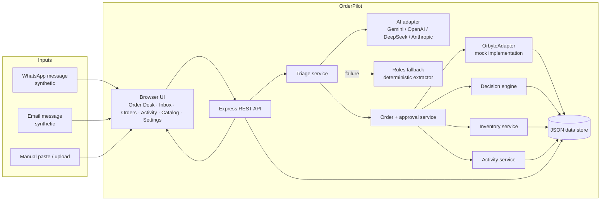
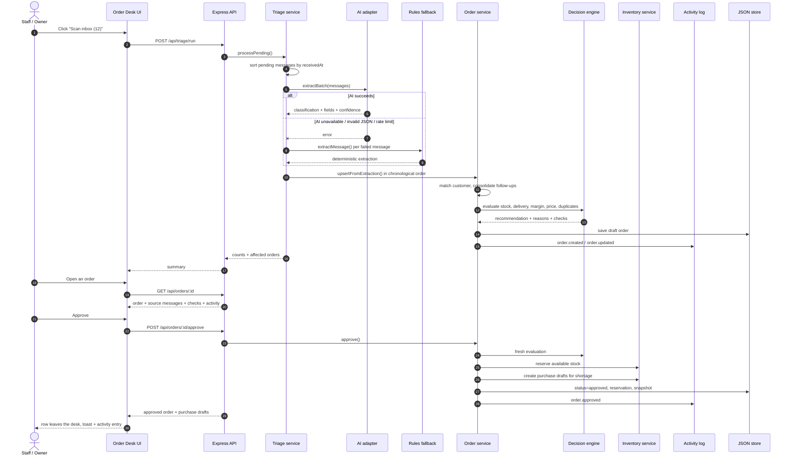

# OrderPilot — Architecture

This document explains how the demo works end to end, why the components are separated the way they are, and where a production system would extend them.

---

## 1. Goals

OrderPilot is deliberately a **single complete journey**, not an ERP:

1. A business event arrives: a WhatsApp/email order.
2. The system connects the relevant business data: customer, catalogue, stock, cost, supplier lead time.
3. Deterministic rules decide what should happen: accept, procure, ask for information, review or reject.
4. A human with the right role approves the consequential action.
5. The outcome is visible and recorded: order record, stock reservation, purchase draft, activity log.

Non-goals for the MVP: real payments, real supplier purchase orders, statutory filings, full accounting, full identity management, or a live Orbyte connection.

---

## 2. System context



The browser never calls the AI provider directly. The API key stays on the server.

---

## 3. The core journey



---

## 4. Frontend architecture

The frontend is intentionally dependency-free: semantic HTML, a hand-written CSS design system, and small ES modules. There is no build step, which keeps Replit deployment and judge inspection simple.

```text
public/js/
├── app.js                  # shell, hash router, global actions, nav counts
├── api.js                  # fetch wrapper + demo actor header
├── ui.js                   # DOM helpers, formatting, toast, modal, focus trap
├── icons.js                # trusted inline SVG icon set
├── components/
│   ├── orderTable.js       # the dense order desk table
│   ├── orderDrawer.js      # detail, checks, sources, approvals
│   └── scanOverlay.js      # staged scan animation + result summary
└── pages/
    ├── desk.js
    ├── inbox.js
    ├── orders.js
    ├── activity.js
    ├── catalog.js
    └── settings.js
```

### State and data flow

- `app.js` keeps a small mutable `state`: bootstrap, actor, route, filters, the last import result and the IDs of newly arrived orders.
- Pages fetch their own data through `api.js`, render into `#content`, and attach local handlers.
- Global actions (`scanInbox`, `openOrder`, `afterMutation`, `exportData`, `resetDemo`) live in `app.js` so every page behaves the same after a mutation.
- `afterMutation()` refreshes `/api/bootstrap` (nav counts, AI status), then re-renders the current route. The nav counts are data attributes, so they update without rebuilding the sidebar.
- The role switcher writes the simulated actor id to `localStorage`; every API request sends `X-OrderPilot-User`.

### Why vanilla JS

- Zero build step on Replit.
- The table is the product; a large SPA framework would add deployment risk without improving the one-screen experience.
- The modules are small and testable through the API; UI logic is mostly rendering.

### UX decisions

- The **Order Desk is the default route**. Raw messages are not the primary experience.
- Each row is an order, not a message. Follow-ups merge into one row.
- Non-orders are filtered silently; only a count appears.
- The primary action is on the far right and remains sticky when the table scrolls horizontally.
- Risky rows do not offer a one-click approve — they open the drawer, where the evidence and a required note live.
- The drawer is the audit surface: recommendation reasons, stock lines, supplier lead times, price deviations, source messages and activity in one place.

---

## 5. Backend architecture

```text
server/
├── index.js                # dotenv, listen, shutdown
├── bootstrap.js            # ensure files, create repositories, services, app
├── app.js                  # Express routes, actor middleware, exports, errors
├── config.js               # env parsing, AI provider detection, rules
├── domain/
│   ├── constants.js        # statuses, recommendations, actions, roles
│   ├── dates.js            # MYT today, natural-language delivery dates
│   ├── money.js            # integer-cent calculations, MYR formatting
│   └── validation.js       # phones, emails, customer keys, CSV escaping
├── repositories/
│   ├── jsonStore.js        # atomic JSON persistence + write queue
│   ├── stores.js           # one store per file
│   ├── catalogRepository.js
│   ├── messageRepository.js
│   ├── orderRepository.js
│   ├── activityRepository.js
│   ├── purchaseDraftRepository.js
│   ├── userRepository.js
│   └── runtime.js          # seed copy / destructive reset
├── services/
│   ├── triageService.js    # import, AI/fallback extraction, batch summary
│   ├── orderService.js     # consolidation, decisions, approvals, edits
│   ├── decisionEngine.js   # pure rules
│   ├── consolidation.js    # add / replace / remove / update
│   ├── inventoryService.js # reserve, release, purchase drafts, receive
│   ├── activityService.js  # audit entries
│   └── seedService.js      # deterministic first boot
└── adapters/
    ├── ai/
    │   ├── aiClient.js     # provider selection, batch parsing, normalization
    │   ├── providers.js    # OpenAI-compatible / Gemini / Anthropic HTTP
    │   ├── prompts.js      # system prompt, catalogue, output schema
    │   └── fallbackExtractor.js
    └── orbyte/
        ├── orbyteAdapter.js
        └── mockOrbyteAdapter.js
```

### Layer responsibilities

| Layer | Knows about | Does not know about |
| --- | --- | --- |
| Routes (`app.js`) | HTTP, actor header, status codes, export formats | Stock math, AI prompts |
| Services | Business rules, consolidation, approval workflow | Express, CSS |
| Decision engine | Pure functions over products/stock/suppliers/orders | Storage, HTTP, AI |
| Adapters | Provider protocols, Orbyte contract | Order workflow |
| Repositories | JSON files and atomic writes | Business rules |
| Domain | Dates, money, validation, constants | Any I/O |

The decision engine is a pure function. That is why it can be tested exhaustively without a server, a browser or an API key.

---

## 6. Data model

### Product

```json
{
  "sku": "BEAN-ARABICA-1KG",
  "name": "Arabica Coffee Beans",
  "aliases": ["arabica", "biji kopi arabica"],
  "category": "Coffee",
  "unit": "1kg box",
  "sellingPrice": 58,
  "unitCost": 42,
  "supplierId": "SUP-BEAN",
  "safetyStock": 10
}
```

### Stock

```json
{ "sku": "BEAN-ARABICA-1KG", "onHand": 48, "reserved": 12, "lastCountedAt": "2026-10-18" }
```

Available = `onHand − reserved` (never below zero in the check).

### Supplier

```json
{
  "id": "SUP-DAIRY",
  "name": "FarmFresh Distribution",
  "leadTimeDays": 1,
  "minOrderValue": 150,
  "paymentTerms": "Net 7"
}
```

### Customer

Synthetic master data with a business name, contact, phone, email, address, type and notes. A customer is matched by phone key, email or normalized name. A new prospect can be stored on the order without being added to the master.

### Message

```json
{
  "id": "MSG-1001",
  "channel": "whatsapp",
  "from": "+60123456789",
  "fromName": "Nurul Aisyah",
  "subject": null,
  "body": "Hi kak, nak order 20 boxes Arabica…",
  "receivedAt": "2026-10-21T…",
  "status": "processed | filtered | new | error",
  "analysis": { "isOrder": true, "category": "order", "items": [], "confidence": 0.95 },
  "orderId": "ord_op-1001",
  "orderCode": "OP-1001"
}
```

### Order

```json
{
  "id": "ord_op-1001",
  "code": "OP-1001",
  "status": "draft | needs_info | approved | rejected | cancelled | superseded",
  "customerKey": "phone:123456789",
  "customer": { "name": "…", "phone": "…", "address": "…", "addressSource": "profile" },
  "items": [
    { "sku": "BEAN-ARABICA-1KG", "quantity": 25, "unitPrice": 58, "unitCost": 42, "marginPct": 27.6 }
  ],
  "deliveryDate": "2026-10-23",
  "sourceMessageIds": ["MSG-1001", "MSG-1002", "MSG-1012"],
  "confidence": 0.85,
  "extractionMode": "ai | rules | mixed",
  "recommendation": { "code": "READY", "severity": "success", "reasons": [] },
  "checks": { "stock": {}, "delivery": {}, "profit": {}, "price": {}, "duplicate": {}, "completeness": {} },
  "totals": { "revenue": 1512.5, "cost": 1095, "grossProfit": 417.5, "marginPct": 27.6 },
  "reservation": [{ "sku": "BEAN-ARABICA-1KG", "quantity": 25 }],
  "purchaseDraftIds": [],
  "approvedBy": { "id": "u-aina", "name": "Aina Rahman", "role": "owner" },
  "approvedAt": "…",
  "createdAt": "…",
  "updatedAt": "…"
}
```

### Purchase draft

```json
{
  "id": "PD-1001",
  "orderId": "ord_op-1003",
  "orderCode": "OP-1003",
  "supplierId": "SUP-DAIRY",
  "supplierName": "FarmFresh Distribution",
  "items": [{ "sku": "MILK-OAT-1L", "quantity": 10, "unitCost": 11, "lineCost": 110 }],
  "expectedDate": "2026-10-23",
  "status": "draft | received",
  "estimatedCost": 110,
  "note": "Internal draft only…"
}
```

### Activity

```json
{
  "id": "ACT-1005",
  "at": "2026-10-21T…",
  "actor": { "id": "u-aina", "name": "Aina Rahman", "role": "owner" },
  "action": "order.approved",
  "entityType": "order",
  "entityId": "ord_op-1002",
  "orderId": "ord_op-1002",
  "summary": "OP-1002 approved by Aina Rahman…",
  "details": {}
}
```

### Persistence

- `data/seed/*.json` is committed and is the source of truth for the demo.
- `data/runtime/*.json` is created on first boot and is gitignored.
- `JsonStore` keeps an in-memory cache, writes to a temporary file, then renames it (atomic on the Replit Linux filesystem).
- A per-store promise queue serialises read-modify-write cycles. This avoids lost updates when two requests touch the same file.
- The demo reset deletes the runtime directory, copies the seed, invalidates caches and replays the seed messages.

**Why not SQLite?** A native SQLite dependency adds a build/ABI risk on Replit and is unnecessary for a demo with a few dozen records. The repository interface is the seam: a SQLite/Postgres implementation can replace `JsonStore` without touching services or routes.

---

## 7. Decision engine

`evaluateOrder(order, context)` is pure. It receives products, suppliers, stock, existing orders, today and rules, and returns a snapshot. It never writes.

### 7.1 Normalization

For each line:

- Resolve the SKU by exact SKU, then by product name/alias.
- If `unitPrice` is absent, use the catalogue selling price; otherwise use the quoted price.
- Calculate line revenue, cost, profit and margin in integer cents.
- Flag unknown products, invalid quantities and unit mismatches.

### 7.2 Completeness

Required fields:

1. Customer name (contact name or business name).
2. Contact (phone or email).
3. At least one valid item.
4. Delivery date.
5. Delivery address.

A profile address can satisfy the address requirement; the drawer shows “From customer profile”.

### 7.3 Stock

For each matched line:

```text
available          = max(0, onHand − reserved)
shortage           = max(0, required − available)
postOrderAvailable = available − required
belowSafety        = shortage == 0 && postOrderAvailable < safetyStock
totalLeadDays      = supplier.leadTimeDays + handlingDays
canRestockInTime   = shortage > 0 && daysUntilDelivery >= totalLeadDays
```

The engine also calculates the estimated restock cost and whether it meets the supplier's minimum order value. The MOQ is shown as a warning, not a hard block; the manager can combine purchase drafts.

### 7.4 Delivery

```text
valid      = deliveryDate is a valid calendar date
past       = daysUntil < 0
feasible   = every shortage line canRestockInTime
deliveryOk = valid && !past && feasible
```

No date is a completeness problem. A past date is high risk. A shortage with a lead time beyond the date is high risk.

### 7.5 Profit and price

- Revenue = Σ(quantity × unit price)
- Cost = Σ(quantity × unit cost)
- Gross profit = revenue − cost
- Gross margin = gross profit / revenue
- A line whose quoted price is below unit cost is flagged.
- A quoted price that differs from catalogue by more than the threshold is a price deviation.

### 7.6 Duplicate

Same customer key, overlapping SKU, and an existing draft/needs-info/approved order created within the duplicate window. A change request skips the duplicate check.

### 7.7 Recommendation priority

```text
if missing fields / unknown product / invalid quantity / unit mismatch:
    NEEDS_INFO
else if past delivery / shortage cannot be restocked / negative margin / quote below cost:
    HIGH_RISK
else if shortage can be restocked:
    PROCUREMENT
else if low margin / below safety / price deviation / duplicate / low confidence:
    REVIEW
else if change request:
    CHANGE_REQUEST
else:
    READY
```

- `NEEDS_INFO` blocks approval until the manager edits the order or requests information.
- `HIGH_RISK` is approvable only with a justification note.
- `PROCUREMENT` creates one internal purchase draft per supplier.
- `REVIEW` is approvable in one click; the warnings stay visible.
- `READY` is the clean path.

---

## 8. AI adapter and fallback

### 8.1 Division of labour

| AI | Rules |
| --- | --- |
| Is this message an order? | Available stock |
| Which fields are present? | Shortage and safety stock |
| Product/quantity/price/address/date extraction | Supplier lead time vs delivery |
| Add / replace / remove / update intent | Revenue, cost, profit, margin |
| Confidence | Price deviation, duplicates, completeness |
| | Recommendation and audit |

The AI never sees or decides stock, cost or risk.

### 8.2 Provider abstraction

Supported providers:

- Google Gemini (`generateContent`, JSON response mode)
- OpenAI (`chat/completions`, JSON object mode)
- DeepSeek (OpenAI-compatible)
- Anthropic (`messages`)
- Any OpenAI-compatible base URL

Selection:

```text
AI_PROVIDER = auto | gemini | openai | deepseek | anthropic | openai-compatible | rules
```

`auto` detects a provider-specific key (`GEMINI_API_KEY`, `OPENAI_API_KEY`, `DEEPSEEK_API_KEY`, `ANTHROPIC_API_KEY`) or falls back to `rules`.

Messages are sent in chunks (default 10) with a compact catalogue and a strict output schema. The server validates and normalizes the response: SKU mapping, quantity/price clamping, date validation, allowed categories and operations, missing-field filtering, and confidence clamping.

### 8.3 Failure model

- Timeout (default 45s), one retry on 408/429/5xx.
- Invalid JSON → the batch falls back to the deterministic extractor.
- Provider 401/403 → surface a clear error; the demo still runs in rules mode.
- A partially successful batch uses AI for successful messages and rules for the rest; the UI shows “Mixed”.
- The activity log records `ai.fallback` with the reason.

### 8.4 Rules fallback

The deterministic extractor (`server/adapters/ai/fallbackExtractor.js`) includes:

- Message classification (order, update, inquiry, ad, supplier, payment, spam, other).
- Alias-based product matching with long-alias priority.
- Quantity extraction with unit words, price/date/phone guards and size-vs-quantity handling.
- Malaysian phone/email/address extraction.
- Relative date parsing (`this Friday`, `next Monday`, `tomorrow`, `hantar Jumaat`, `24 Oct 2026`).
- Add / replace / remove / update detection, including “change the Arabica to 25 boxes”.
- Customer matching by phone key, email or normalized name.
- Confidence scoring.

This is why the demo never depends on a live AI call. It is labelled “Rules fallback” throughout the UI, so the judges always know which mode is active.

---

## 9. Consolidation

The order service groups messages by `customerKey` within the consolidation window (72h).

- A plain new order from the same customer inside the window is treated as an **add**.
- `add` merges quantities for the same SKU and appends new products.
- `replace` sets a new quantity for the matching SKU.
- `remove` deletes a line; an empty remove cancels a draft.
- `update` changes delivery date/address/notes without touching items.
- An update to an **approved** order creates a **change request** (a new draft with `parentOrderId`). Approving it releases the parent reservation, supersedes the parent and reserves the new quantities.
- A cancellation update creates a change request with `cancellationRequested`; approving it releases the parent reservation and cancels the parent.

The order stores every source message id. The drawer shows all source messages and the consolidation history.

---

## 10. Approval, inventory and audit

### Approval preconditions

1. The actor is the Owner/Manager (server check).
2. The order is `draft` or `needs_info`.
3. A fresh evaluation says `canApprove` (no missing/unmatched data).
4. If the recommendation is high risk, a justification note is present.
5. If the order is a procurement order, the manager confirms the purchase draft creation.

### Approval effects

- Reserve `required − shortage` units per line (`reserved` increases).
- Create one purchase draft per supplier for the shortage.
- Store a snapshot of the checks, totals, reservation and purchase draft ids.
- Set `status=approved`, `approvedBy`, `approvedAt`, `approvalNote`.
- Write `order.approved`, `stock.reserved` and `purchase_draft.created` activities.

### Receiving stock

Marking a purchase draft received:

- Increases `onHand` by the delivered quantity.
- Increases `reserved` by the same quantity, because the stock is committed to the order.
- Adds the quantity to the order reservation.
- Marks the draft `received`; clears `procurementPending` when no drafts remain.
- Writes `purchase_draft.received`.

### Audit

Every important action writes an entry with actor, role, action, entity, order, summary and details. The log is append-only in the app; the only way to clear it is the explicit manager demo reset, which is itself logged.

---

## 11. Orbyte adapter

The rest of the app talks to `OrbyteAdapter`:

```js
getCatalog()                 -> Product[]
getInventory()               -> StockRow[]
getSuppliers()               -> Supplier[]
getCustomers()               -> Customer[]
createPurchaseDraft(draft)   -> PurchaseDraft
emitAuditEvent(event)        -> Activity
```

`MockOrbyteAdapter` reads/writes the synthetic JSON dataset. A production adapter would:

- Authenticate with Orbyte SSO / OAuth client credentials.
- Map OrderPilot products to Orbyte catalogue items and stock locations.
- Create purchase drafts in an Orbyte procurement module via the Connect/Open API.
- Emit audit events to Orbyte's audit trail.
- Use idempotency keys for retries.
- Respect Orbyte roles and permissions rather than the demo actor header.

Because the services depend on the interface, not the mock, this is a contained change. See [`ORBYTE_ADAPTER.md`](ORBYTE_ADAPTER.md).

---

## 12. Security and privacy

- **Server-side secrets.** The AI key is read from `process.env`; the browser never receives it. `.env` is gitignored. Replit Secrets are used in deployment.
- **Simulated identity.** The actor header is a demo device. The server still enforces role permissions. A real deployment would replace it with Orbyte SSO and signed sessions.
- **Input validation.** Message bodies are bounded, JSON bodies are limited to 256KB, AI endpoints are rate-limited, and unknown actor ids are rejected.
- **Output safety.** User text is rendered with `textContent`; only a trusted inline SVG icon set uses `innerHTML`. CSV cells starting with `= + - @` are prefixed to prevent formula injection.
- **Headers.** CSP, `X-Content-Type-Options`, `X-Frame-Options`, `Referrer-Policy` and a restrictive permissions policy are set.
- **No real data.** Every record is synthetic. No real payments, purchase orders or statutory filings are processed.
- **PDPA.** Purpose limitation, minimisation, retention, access control and audit are documented in [`PRIVACY.md`](PRIVACY.md).

---

## 13. Testing

```bash
npm test
```

The suite runs with Node's built-in test runner. It uses a temporary runtime directory for API tests, so it never touches the demo data.

| File | Coverage |
| --- | --- |
| `decisionEngine.test.js` | Ready, procurement, high risk, needs info, review, safety, duplicate, unknown product |
| `fallbackExtractor.test.js` | WhatsApp/email extraction, Malay wording, updates, filtering, prices, missing fields |
| `consolidation.test.js` | Add, replace, remove, remove-all, notes, customer merge, date merge |
| `dates.test.js` | Relative/explicit dates, delivery hints, arithmetic |
| `aiNormalization.test.js` | AI SKU mapping, invalid dates, confidence clamping, non-orders |
| `api.test.js` | Health, bootstrap, owner approval, staff 403, request info, rejection, CSV/XLSX, reset, triage |

The UI was also exercised in a headless browser at 1440×1050 and 390×844: desktop pages, order drawer, scan overlay, approval, request-info modal, staff permissions and the mobile off-canvas navigation.

---

## 14. Deployment

- `.replit` runs `npm start` with Node 20.
- `server/index.js` listens on `0.0.0.0:${PORT}`.
- Static files are served by Express; no build step.
- The seed is copied to `data/runtime` on first boot.
- Replit Autoscale deployments may reset the filesystem on cold starts; the app re-seeds automatically. For a persistent demo, use a Reserved VM or move the repository layer to Replit PostgreSQL/Replit DB.
- The demo reset is available in Settings (Owner only) and as `npm run reset` locally.

---

## 15. Known limitations

- JSON files are single-process storage; this is appropriate for a demo, not multi-instance production.
- The simulated actor header is not real authentication.
- Consolidation merges all messages from a customer inside 72 hours; a production UI would offer split/merge.
- Change requests supersede the original order only when approved; purchase drafts from the parent are not auto-cancelled.
- The AI adapter uses one extraction call per chunk and does not stream; a production system would add caching, cost tracking and observability.
- Replit Autoscale filesystem persistence is not guaranteed.
- The app does not send WhatsApp/email replies; it generates a copyable draft (by design, to avoid real messaging during the demo).

---

## 16. Why this design fits the domain brief

- **Specific pain:** order information scattered across WhatsApp/email/Excel, with missed orders and wrong stock promises.
- **AI where it adds value:** reading unstructured messages and extracting fields, not deciding business risk.
- **Human control:** server-enforced roles, explicit approve/reject/request-info, required notes for high risk, audit trail.
- **Accuracy and ease of learning:** one table, plain labels, visible reasons, no training required.
- **Orbyte fit:** the adapter seam and the “connected business context” story; the order desk is a capability that could sit inside the Orbyte hub.
- **Reusable:** synthetic data, environment rules, provider-agnostic AI and a mock adapter make it configurable for many SMEs.
- **Business benefit:** fewer missed orders, fewer wrong quotes, less evening admin; the demo shows measured batch processing and estimated minutes saved.
